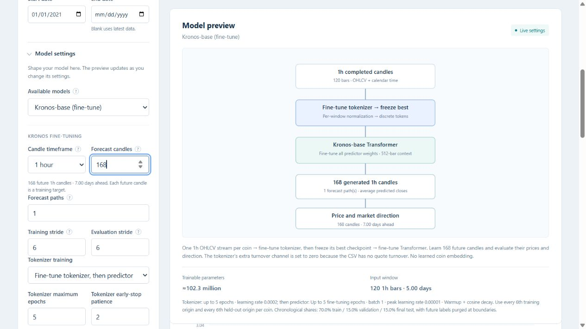

# Configurable Kronos candle forecasts

Kronos fine-tuning now learns a configurable number of future candles instead
of requiring a 30-day sequence with three fixed daily targets.

- Training accepts 15m, 1h, 4h and 1d candle streams.
- `kronos_prediction_length` defaults to 24; the UI calls it Forecast candles.
- Targets, generation, price/movement metrics, residual ranges and CSV/JSON
  outputs follow every selected future candle.
- Split purging follows the actual target end; new runs no longer require
  seven preceding days solely to calculate a drift baseline.
- Training retains its architecture budget: input + future - 1 <= 512 tokens.
- New checkpoints use format 4. Format 3 checkpoints without the new setting
  retain their original 1/7/30-day target definitions and reload offline.
- Chart forecasting and model testing load both checkpoint formats.
- Saved forecasts display their actual candle horizons, including hours/minutes.
- Examples use hourly candles, 120 input bars, 24 target bars, and batch size 1.

Validation exercises real tiny upstream tokenizer/predictor modules with both
training stages, gradients, all four intervals, each future close, chronological
purging, prediction reload equality, legacy checkpoint reloads, saved chart
inference, CLI validation, and dashboard HTTP settings/context rejection.

Browser verification confirms hourly selection, a 168-candle seven-day target,
the resulting 345-bar maximum lookback, and saved 1/2/3-hour forecast choices.
The test runs use synthetic fixtures; they verify implementation correctness,
not improvement in market forecast accuracy.

Final verification: **417 tests passed** in 69.87 seconds; JavaScript syntax check passed. The temporary preview server was stopped after browser verification.
