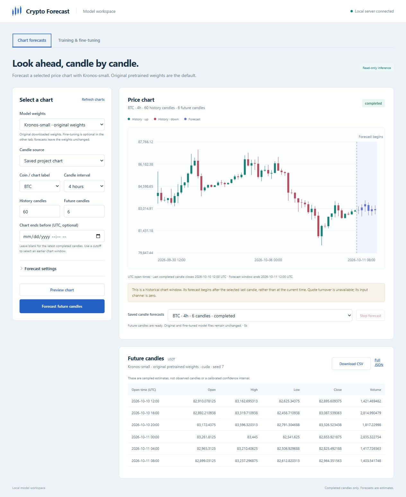
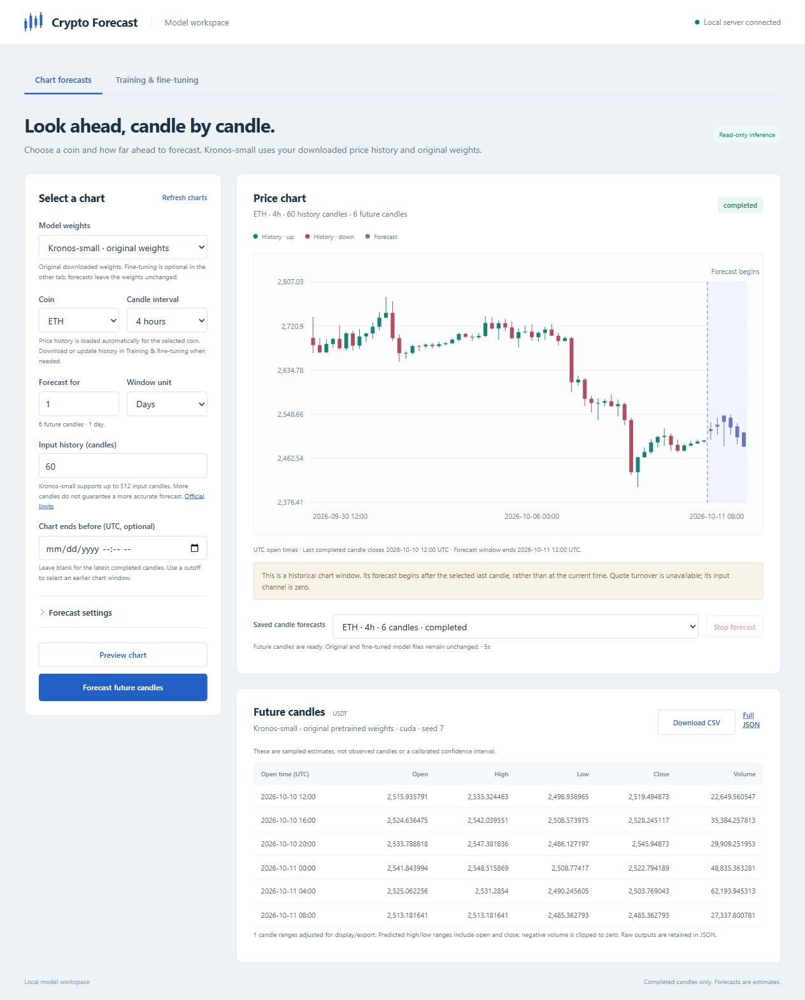

# Original-weight chart forecasts

The browser opens on **Chart forecasts**, separate from **Training & fine-tuning**.
The default predictor uses the original downloaded Kronos-small model and base
tokenizer. Optional fine-tuning saves independent checkpoints; chart inference
never trains or writes model weights.

Verified with the installed `.venv-kronos` environment:

- Full project suite: **332 passed**. After adding a saved fine-tuned checkpoint
  compatibility test, the chart-specific suite passed **28 tests**.
- Both browser JavaScript files pass `node --check`.
- Real original-weight GPU inference: 60 historical BTC four-hour candles to
  six future OHLCV candles; job completed in about five seconds including model
  loading. Inputs came from a copied project CSV in an isolated test workspace.
- Uploaded BTC chart CSV: 30 history candles to three future candles; forecast
  completed on CUDA, and CSV export contained the expected timestamps and values.
- A 512-candle forecast was stopped through the browser; its saved job is
  `stopped` and has no published forecast result.
- Saved forecasts reopen after a browser reload, restoring settings and input
  context. The optional training tab retains Kronos fine-tuning controls.
- Tiny genuine upstream modules exercise read-only original and fine-tuned
  inference, repeatable CPU sampling, timestamp/cutoff and gap validation,
  candle validity, job serialization, HTTP/CSRF boundaries, and compatibility.

The original weights and the copies used for browser inference had matching
SHA256 hashes after these forecasts and cancellation:

| File | SHA256 |
| --- | --- |
| Predictor `model.safetensors` | `b082dfcbd8e8c142a725c8bbb99781802f38fec81210e13479effb32b3c3e020` |
| Tokenizer `model.safetensors` | `59d85f6af76a2c3b8240ea06cb21db4213b4eeca053f246b23e29cf832fc6bee` |

The example chart ended at 2026-10-10 12:00 UTC and was explicitly labeled
historical. These checks establish that integration, rendering, export and
cancellation work; they do not measure forecasting accuracy.

## Coin and forecast-window controls

The browser now loads downloaded history automatically after selecting a coin
and candle interval. CSV selection is removed. Users choose the forecast duration
in hours, days or candles; incomplete intervals round up with a visible note.
Input history is capped at the official Kronos-small context of 512 candles.

- Focused Python chart/dashboard suite: **42 passed**.
- Node window conversion and boundary tests: **4 passed**.
- Browser: seven days at four-hour intervals becomes 42 future candles;
  seven days at fifteen-minute intervals is rejected as 672 future candles.
- Real browser ETH forecast: 60 four-hour history candles to six future candles
  for a 24-hour window, completed on CUDA in five seconds.
- Original predictor and tokenizer hashes still match the hashes above.

The selected downloaded history ends at 2026-10-10 12:00 UTC; the browser
explicitly labels this historical origin. Update candles in the training tab
to forecast after newer data.

