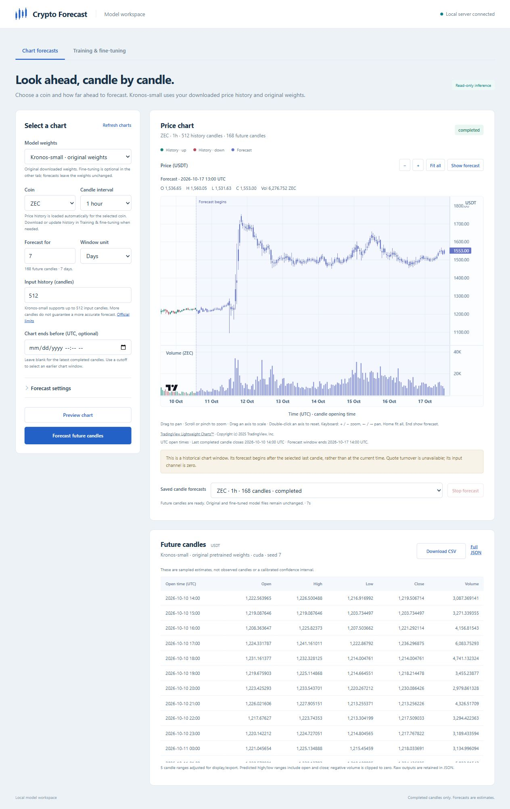

# Interactive price and volume charts

The chart tab uses locally bundled TradingView Lightweight Charts 5.2.1.
Historical and forecast prices and base-asset volume share UTC timestamps across
two panes. Purple candles and bars distinguish forecast values; a shaded region
and dashed boundary stay aligned while panning and zooming. Price is labeled in
USDT, volume in the selected base coin, and time in UTC.

Verified in the local browser:

- ETH: 60 historical and six forecast candles, with historical and forecast volume.
- ADA history-only preview: base-coin volume and price ticks with three decimals.
- ZEC: 512 history and 168 forecast candles. Fit all displays the complete 680-bar
  window; Show forecast focuses the future bars with 24 preceding history bars.
- Mouse-wheel zoom, drag-to-pan, keyboard zoom, crosshair OHLCV/time readout,
  price-axis drag/reset, resizable volume pane, and switching between tabs.
- Browser console: no errors during these checks.

Focused Python chart/dashboard suite: **42 passed**. Node window conversion,
volume mapping, forecast distinction, price precision, and UTC formatting:
**8 passed**. JavaScript syntax checks pass. A local wheel build includes the
renderer, pinned library bundle, LICENSE, NOTICE, and provenance documentation.

This changes rendering and navigation; saved forecast values and weight files
are unchanged. Forecast volume is a sampled model estimate.

