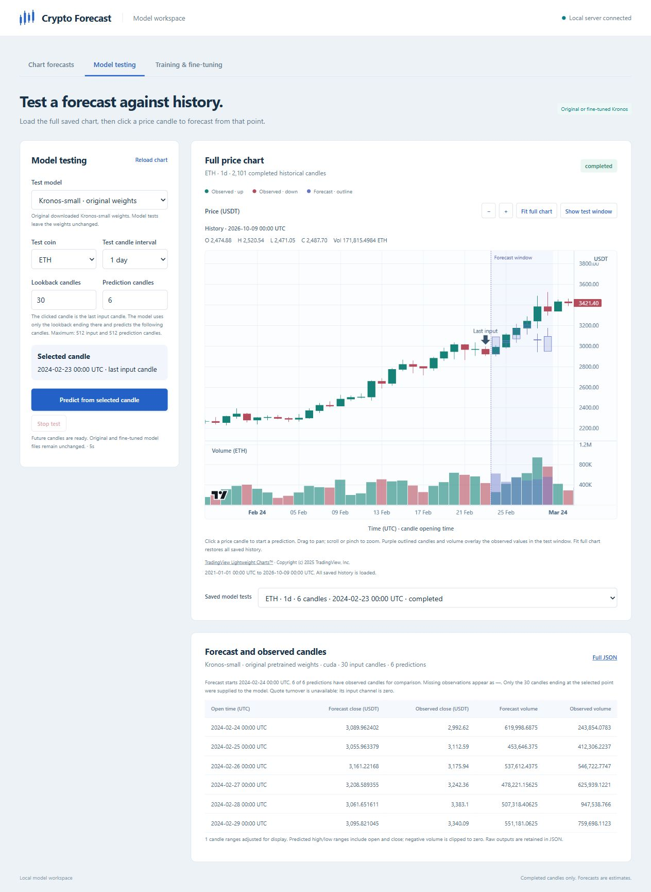

# Historical model testing

The dashboard's Model testing tab loads all completed saved candles for a coin
and interval. Clicking a price candle starts read-only Kronos inference with
that candle as the final input. Lookback accepts 2–512 candles; prediction count
accepts 1–512. Forecast price candles and volume use separate series on the same
time and price scales as the observed chart, allowing timestamps to overlap
without replacing observations.

Validation:

- 138 Python tests passed across model testing, chart forecasting, dashboard,
  and Kronos dashboard tests. Coverage includes full histories beyond 512,
  missing/early/nonexistent anchors, gaps, CSRF protection, saved job results,
  and future observations changing without affecting predictions or weights.
- 9 Node tests passed for chart data, UTC labels, forecast duration boundaries,
  and price precision on a 200,000-candle history.
- Browser loaded 202,355 BTC 15-minute candles spanning January 2021 to October
  2026, and 2,101 ETH daily candles. Fit full chart displayed the entire range.
- A chart click at ETH 2024-02-23 00:00 UTC produced six candles on CUDA from a
  30-candle context in five seconds. All six forecast timestamps matched saved
  observations. Purple forecast price/volume overlaid those observations.
- Dragging panned without starting a test. Clicking the volume pane showed
  actual and forecast close/volume in the readout without starting a test.
- Reloading and choosing the saved test restored model, coin, interval, input
  counts, selected point, comparison table, and forecast overlay. No browser
  errors were reported.
- Original predictor/tokenizer SHA-256 hashes remained
  `b082dfcbd8e8c142a725c8bbb99781802f38fec81210e13479effb32b3c3e020`
  and `59d85f6af76a2c3b8240ea06cb21db4213b4eeca053f246b23e29cf832fc6bee`.

