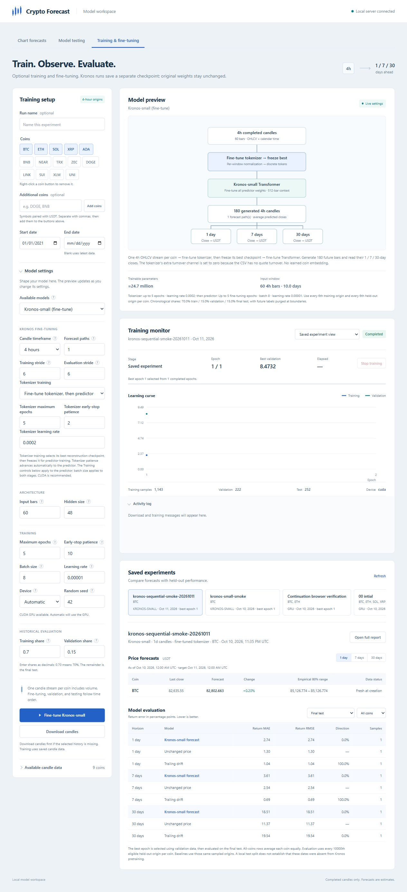

# Sequential Kronos fine-tuning verification

Kronos training now adapts the tokenizer before the predictor by default.
The tokenizer objective is `(coarse MSE + full MSE + BSQ loss) / 2`, with
full reconstruction validation MSE selecting its best checkpoint. That
checkpoint is restored and frozen before the predictor's token datasets are
generated. Both stages use the same chronological purged splits; the test
partition is reserved for evaluation after predictor checkpoint selection.

Separate tokenizer epoch, patience, and learning-rate controls are available
in JSON, CLI, and the dashboard. `--no-kronos-finetune-tokenizer` retains
predictor-only training. Old predictor-only runs still load, and new runs
save the matched tokenizer/predictor pair plus both stages' histories.

The real-weight CUDA smoke run is saved in
`runs/kronos-sequential-smoke-20261011`. It uses local BTC daily candles,
60 historical input bars, two tokenizer epochs, one predictor epoch, and
strides of 10,000, yielding one train, validation, and test origin each.

Verified:

- Tokenizer and predictor weights both changed.
- Tokenizer validation selected epoch 2, with full reconstruction MSE
  `0.07139001041650772`.
- Checkpoint reload reproduced all saved forecasts exactly on the same device.
- SHA-256 hashes of the original predictor/tokenizer weight files remained
  unchanged.
- Tests cover real gradients through tokenizer encoder, both reconstruction
  paths, decoder and quantization projection; best tokenizer restoration
  before predictor tokenization; unchanged tokenizer in predictor-only mode;
  non-finite validation rejection; and separate dashboard histories.
- Browser checks verified the default sequential option and disabling/re-enabling
  tokenizer controls in predictor-only mode.
- JavaScript syntax validation passed.
- Final full regression suite: **365 passed** in 61.14 seconds outside the
  Windows sandbox. A sandboxed retry could not connect to local dashboard
  sockets; the unrestricted run verified the same final source successfully.

The tokenizer's combined training loss was negative (`-0.014840`, then
`-0.016467`) because BSQ includes an entropy regularizer. Validation uses a
different, nonnegative reconstruction objective. The live loss chart handles
negative values, and the standalone report explains the objectives separately.

This smoke run verifies integration and checkpoint pairing. Its tiny sample
counts do not establish forecast accuracy or improvement.

