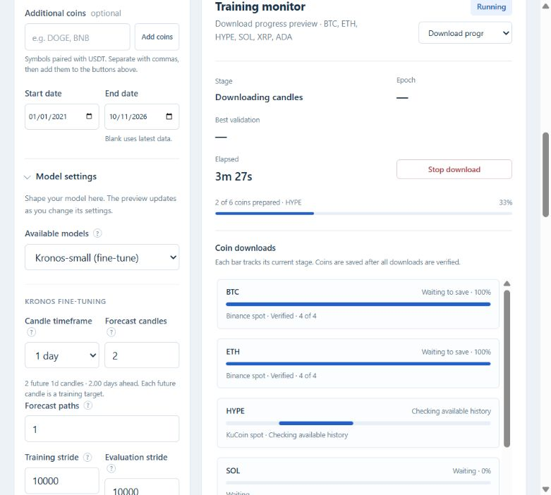

# Per-coin candle download progress

The download monitor now shows one row per selected coin. Archive files and
history pages report completed/total work; source discovery and stages with an
unknown total show a moving indicator. Each percentage describes the current
stage, so changing stages can reset the bar. Source checks, archives, history
pages, verification, timeframe preparation and recent candles have distinct labels.

Workers persist every coin's latest counters, source and status. Writes are
throttled to twice per second except for stage/total changes and stage completion.
Refreshing the page restores these snapshots. Waiting, active, waiting-to-save,
saved, failed, stopped and unstarted states are distinguished. Data is called
saved only after the existing parent-side verified publication succeeds.

Binance archive callbacks consume completed futures immediately while preserving
the prior artifact order and four-worker cap. Cache hits, missing periods and
errors are checked work, rather than falsely counted as successful downloads.
Recent refresh runs per coin using one shared cutoff, with the same validation
and atomic file handling as before. Callback exceptions propagate.

Verification: **510 Python tests passed** in 78.40 seconds outside the Windows
sandbox. JavaScript projection/selection smoke checks and syntax validation passed.
Tests cover acquisition callbacks, asynchronous archive completion, cache/missing
and error cases, stage counts, callback exceptions, worker snapshots, recent
refresh totals, queued coins and stopped/failed display states.

The screenshot below is a **test preview with synthetic progress snapshots**;
no market download was launched for this visual check. Its HYPE source-check row
was not an actual stalled KuCoin transfer. The preview tab and server were closed
after verification. New downloads pick up the worker changes; refresh the dashboard
page to load the new display.

