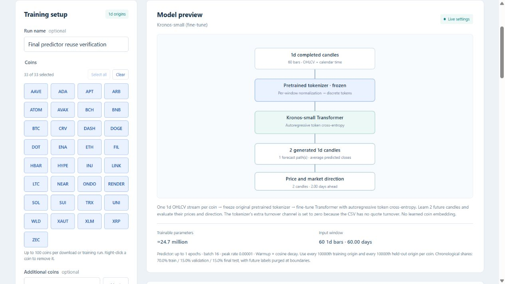

# Coin selection controls

The dashboard accepts up to 100 coins in a download, tokenizer tuning, or
predictor tuning job. Errors above the limit report the actual count and the
100-coin maximum.

Coin choices use an alphabetical responsive grid with equal column widths and
consistent spacing. Select all and Clear update every displayed choice, the
selection count, model preview and persisted selection. Removed choices stay
removed until their symbols are added again. Sorting only moves elements when
their order changes, preserving keyboard focus during ordinary checkbox toggles.

Verified with all 33 coins from the user's screenshot: buttons had identical
60.85-pixel widths at the default desktop viewport; Select all chose all 33;
clearing removed all selections; a reload restored all 33 selected coins; the BTC
checkbox retained keyboard focus after toggling with Space. No production
download or training was launched during this layout check.

Regression verification: 495 Python tests passed in 114.50 seconds outside the
Windows sandbox. JavaScript form/selection smoke checks and syntax validation
passed. The existing server needs a restart to load the new backend limit.

