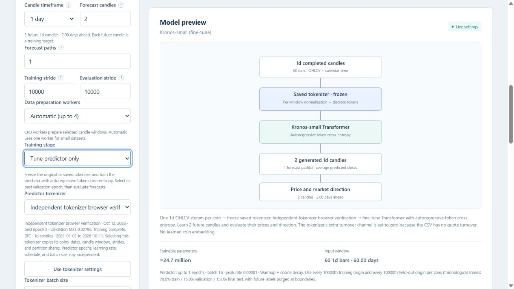

# Independent Kronos tokenizer and predictor tuning

Tokenizer-only jobs optimize the existing coarse/full reconstruction plus BSQ
objective, select full-reconstruction validation MSE, restore the best weights,
and save independently without loading a predictor. Predictor-only jobs load the
selected tokenizer, freeze all of its weights, and optimize future-token cross
entropy with the existing teacher-forcing and causal-validation controls.

Every tokenizer validation improvement is checkpointed before emitting the epoch
event. Its durable best weights remain usable after cancellation or predictor
failure. Atomic publication replaces complete checkpoint files. Interrupted best
checkpoints are marked incomplete; completed tokenizer stages are marked complete.
Dashboard discovery recovers the checkpoint's embedded metadata if cancellation
leaves its JSON inventory view missing or stale. Predictor-only reuse does not
require the original tokenizer files: the saved artifact is self-contained.

Reuse checks a signature of the used candle rows, coins, window definitions,
chronological split boundaries/shares and strides. Changing optimizer settings
or batch size is allowed; changing the data partition is rejected. The final
test is never used to choose tokenizer or predictor weights. Predictor artifacts
contain the selected tokenizer weights and source provenance.

Real-weight CUDA smoke artifacts:

- `runs/kronos-tokenizer-stage-smoke-20261012`: BTC daily candles, 60 input bars,
  2 future bars, 2 tokenizer epochs, tokenizer batch setting 36.
- `runs/kronos-predictor-stage-smoke-20261012`: independent predictor run using
  the saved tokenizer, 1 predictor epoch, predictor batch setting 16.

Strides of 10,000 leave one train, validation and test origin each. The tokenizer
selected epoch 2 with validation reconstruction MSE 0.027960. Both modules changed
from pretrained weights in their own stages. The predictor's saved tokenizer
tensors equal the independent tokenizer checkpoint exactly. SHA-256 checks prove
the source checkpoint and both original pretrained weight files stayed unchanged.
This tiny smoke run verifies integration, not forecast accuracy or GPU capacity
for full batches of 36/16.

Regression tests cover best-epoch restoration, independent batch sizes, tokenizer
only without a predictor or final-test forecasts, frozen source reuse, changed
partitions/data rejection, interruption, predictor failure, source-byte preservation,
dashboard source confinement, inventory, worker completion and CLI flags.

Final verification: **488 Python tests passed** in 80.90 seconds outside the
Windows sandbox; the sandbox retry hit localhost socket restrictions. The
JavaScript form/monitor smoke test and syntax check passed. In an isolated
dashboard, browser-submitted tokenizer-only and predictor-only CUDA jobs both
completed. Source selection restored the tokenizer's data settings while retaining
predictor batch size 16; completed tokenizer curves remained visible.

The existing dashboard server was idle, but Windows denied stopping its process.
It must be restarted and its page reloaded to use the new API. New UI code detects
an older server and explains this requirement before training can be submitted.

Methods checked against upstream:

- [Tokenizer objective, validation and best-checkpoint saving](https://github.com/shiyu-coder/Kronos/blob/master/finetune/train_tokenizer.py)
- [Predictor training with a frozen tokenizer](https://github.com/shiyu-coder/Kronos/blob/master/finetune/train_predictor.py)
